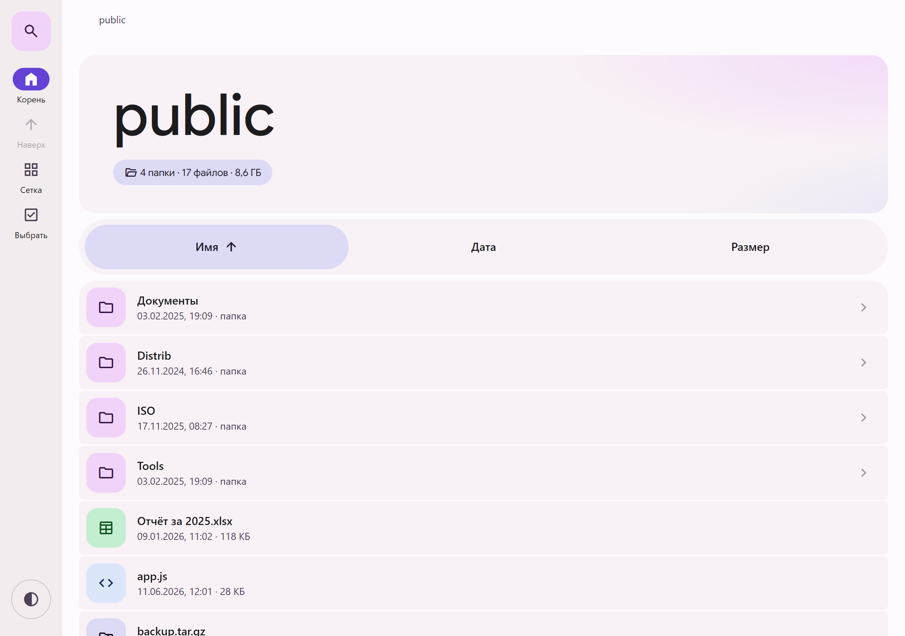
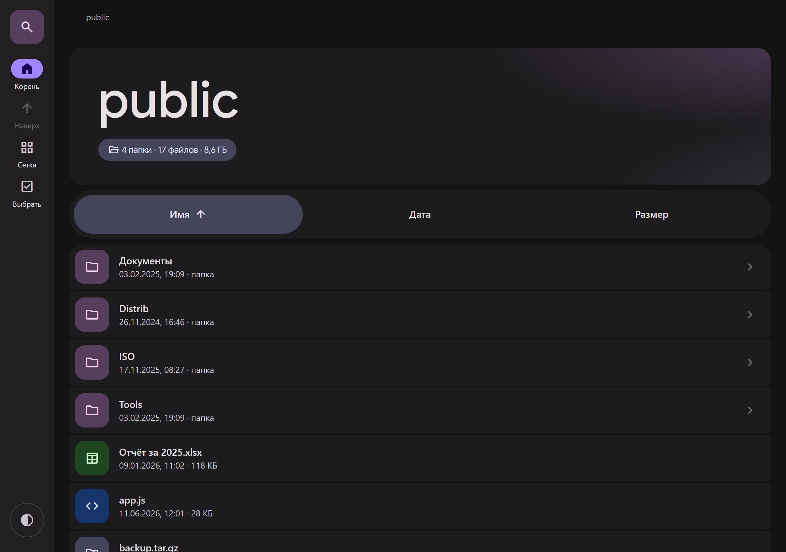
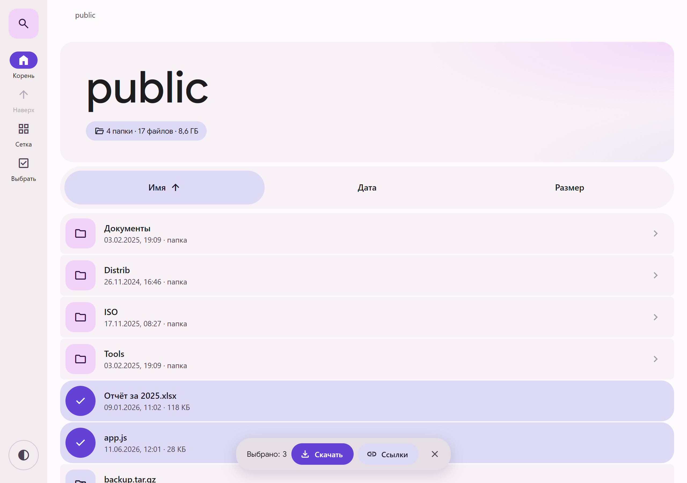
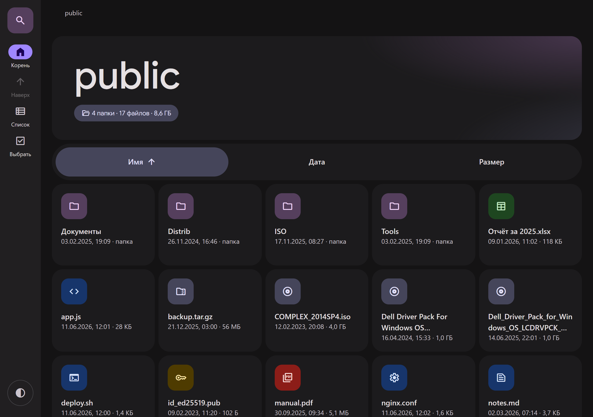
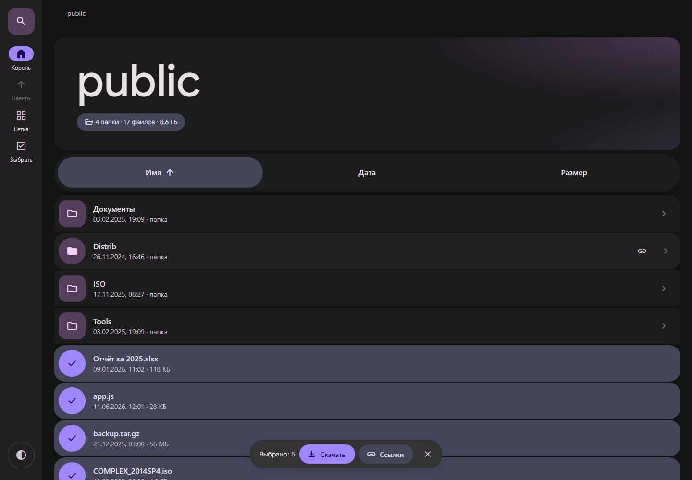
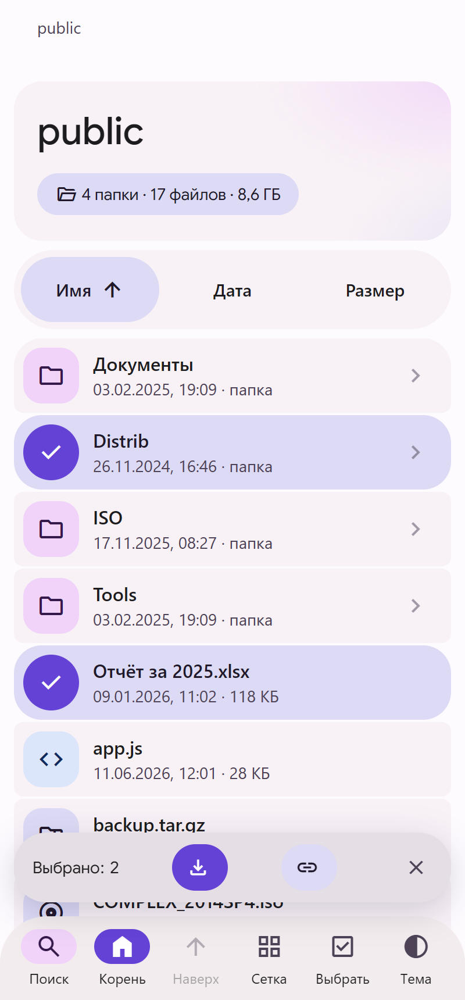

# m3listing

nginx directory listings that look like **[m3.material.io](https://m3.material.io)** — the
same palette, the same type, the same shapes, the same motion.

No backend, no build step. nginx keeps producing its ordinary `autoindex` output; the
browser reads that `<pre>` block and re-renders it as a Material 3 file browser with the
site's 88px navigation rail, hero card, tabbed sort strip, and tonal list.

Three static files. Drop them next to the share and add two lines to nginx.

|             | before        | after                                 |
| ----------- | ------------- | ------------------------------------- |
| server work | none          | none — still one `autoindex` response |
| requests    | 1             | 1 + css + js (both cacheable) + fonts |
| JS disabled | plain listing | plain listing (graceful fallback)     |

<table>
  <tr>
    <td width="50%"></td>
    <td width="50%"></td>
  </tr>
  <tr>
    <td></td>
    <td></td>
  </tr>
  <tr>
    <td></td>
    <td></td>
  </tr>
</table>

## How it works

`ngx_http_addition_module` prepends `top.html` and appends `bot.html` to the autoindex
response. `top.html` opens the document, ships the chrome and loads the script; the nginx
output lands inside a hidden `<div class="rawwrap">`; `bot.html` closes the document.

On `DOMContentLoaded` the script walks `pre a`, taking the **href** as the source of truth
for the file name (nginx truncates the visible label at 50 characters but never the href)
and the text node after each link for the timestamp and size. Everything else — icons,
colours, sorting, search — is derived client-side.

If the script cannot find an autoindex block, or throws, it removes the `m3l-js` class it
set on `<html>` and the original nginx listing becomes visible again. The same happens
with JavaScript disabled: the class is never set, so nothing is hidden.

## Install

1. Copy `dist/` to a dot-directory inside the served root, e.g. `/var/www/html/.m3listing/`.

2. Point the addition module at it:

   ```nginx
   location / {
       root /var/www/html/;
       autoindex on;
       autoindex_localtime on;
       autoindex_exact_size off;      # "on" also works — see below
       charset utf-8;

       add_before_body /.m3listing/top.html;
       add_after_body  /.m3listing/bot.html;

       # nginx emits a full document; strip the duplicate tags
       sub_filter '<html>' '';
       sub_filter '<head><title>Index of $uri</title></head>' '';
       sub_filter '<body bgcolor="white">' '';
       sub_filter '</body>' '';
       sub_filter '</html>' '';
       sub_filter_once on;
   }
   ```

   See [`nginx/example.conf`](nginx/example.conf) for a complete server block.

3. Edit the `window.M3LISTING` block at the top of `top.html`:

   ```js
   window.M3LISTING = {
     title: 'public',      // the name shown on the page
     lang:  'auto'         // 'auto' | 'ru' | 'en'
   };
   ```

   `title` is the brand: it fills the hero at the root, the first breadcrumb and the
   tab title. It defaults to the hostname, which rarely reads well — set it to
   something short. The footer credits this repository; point `repoUrl` elsewhere if
   you would rather it linked to your own fork.

`charset utf-8` matters: without it nginx serves the listing with no charset and non-ASCII
names arrive mojibake'd.

The asset directory name is arbitrary — it only has to match the two paths inside
`top.html` and the two `add_*_body` directives.

## The design is measured, not approximated

Every value below was read off the live site with Playwright computed-style probes
(`tools/` has the probe recipe in its git history) rather than eyeballed:

| | light | dark |
| --- | --- | --- |
| shell | `#FEFBFF` | `#141314` |
| cards / rows | `#F8F1F6` | `#1C1B1D` |
| rail | `#F2ECEE` | `#211F21` |
| hover surface | `#ECE5EB` | `#2A282B` |
| accent | `#6442D6` | `#9F86FF` |
| active pill | `#DCDAF5` | `#45455A` |
| fab / folder chip | `#F1D3F9` | `#553F5D` |

**Type.** `Google Sans` at weight **475** with `font-variation-settings: "GRAD" 0, "opsz" 18`
for display text — that odd weight is what the site actually uses — and `Google Sans Text`
at `"opsz" 17` for everything else. Icons are `Google Symbols`, the same face the site
serves, so the **FILL axis can animate** from outline to solid on hover.

**Shape.** Cards 24px, nav strips 40px, rail items and icon chips 16px, badges 32px, list
rows 8px inside a 24px group. The top strip carries the site's `0 0 40px 40px` corner.

**Motion.** The site uses exactly one easing curve, `cubic-bezier(.2, 0, 0, 1)`, at three
durations, and so does this:

| duration | what moves |
| --- | --- |
| `.2s` | icon `font-variation-settings` (FILL morph), state overlays |
| `.3s` | `border-radius` + `background-color` on rails, rows, tabs, fields; entrance |
| `.5s` | theme cross-fade on every surface |

Layout properties are transitioned too — rail width, shell margin, hero padding, display
font-size, row and chip metrics — so **resizing the window eases** across the breakpoint
instead of snapping.

Plus the site's own hero treatment: a tonal wash that resolves from `blur(50px)` to
`blur(8px)` over 3s on load, from its `blur` keyframes.

`tools/test-motion.mjs` asserts all of it — that no transition uses a foreign curve, that
hover really morphs corner radius, surface and icon fill, and that
`prefers-reduced-motion: reduce` zeroes everything.

```
34/34 passed
```

**File-type accents** are the site's own container colours (its badges, fabs and pills),
not a generated rainbow: purple folders, pink media, green sheets and audio, amber
archives and keys, blue documents and code, red PDFs, neutral for the rest.

## Fonts and privacy

The two `@import` lines at the top of `m3listing.css` are the only external requests.
Google Sans, Google Sans Text and Google Symbols are served from `fonts.googleapis.com`
under Google's [restricted font licence](https://fonts.google.com/license/googlerestricted)
— they are Google's brand faces, hotlinked the same way the site serves them.

Delete both `@import` lines and the page degrades cleanly: the type stack falls back to
Roboto/system fonts and every icon is swapped for inline Material Symbols SVG (the script
checks `document.fonts` and rewrites the glyph spans if the face never arrives). Nothing
leaves the server after that.

## Notes

**`autoindex_exact_size`.** With `off` (the default) nginx rounds sizes to `732M` style
tokens; the skin expands them back to bytes for sorting and totals, inheriting the rounding.
With `on` nginx prints exact byte counts, totals become exact and hovering a row shows the
precise size. Both are supported, nothing to configure.

**`autoindex_format json`** is *not* used. It cannot be combined with the addition module in
one location, and the href already carries the untruncated name, so the only thing JSON
would add is exact sizes — which `autoindex_exact_size on` gives for free.

**`addition_types`** defaults to `text/html`, so the wrapper is glued onto *every* HTML file
served from that location, not just listings. That is why the fallback path matters: for a
real HTML file there is no `pre`, the script bails out and the file renders as itself.

## Features

- Search panel collapsed by default; the rail's search button, `/` or `Ctrl`/`⌘`+`K`
  expand it (height/opacity, the site's own container transition), `Esc` closes and clears
- Instant substring matching with highlighting
- Sort by name, date or size as tabs; click the active tab to flip direction; folders first
- List and grid views, remembered per browser
- Light / dark / follow-system theme, remembered per browser
- Navigation rail on desktop, bottom bar under 768px — the site's own adaptive split
- Clickable breadcrumbs, up button, `Backspace` and `Alt`+`←` to go up
- Arrow keys move a cursor through the rows, `Enter` opens
- Per-row copy-link and download buttons
- **Multi-select and batch download** — the leading chip is also the checkbox (it turns into
  a tick on hover), `Ctrl`/`⌘`+click and `Shift`+click work on the row, `Ctrl`/`⌘`+`A` takes
  everything on screen, and the rail's *Select* button turns on a touch-friendly picking
  mode. A floating action bar then downloads the selected files or copies all their links.
  Downloads are fired one at a time ~350 ms apart, which keeps the browser's
  "allow multiple downloads?" question to a single prompt. There is no backend, so there is
  no server-side zip — folders can be selected for their links but not downloaded
- Folder totals: item counts and the summed size of what is currently shown
- Russian and English UI, auto-selected from `navigator.language`
- Noise filtered out: `@eaDir`, `#recycle`, `Thumbs.db`, `.DS_Store`, the asset dir itself
  (configurable via `hide`)

## Development

```bash
pwsh tools/build-demo.ps1        # demo/index.html = top + a mock autoindex + bot
py -m http.server 8777 --directory demo
node tools/shoot.mjs http://localhost:8777/ screenshots
node tools/test-motion.mjs http://localhost:8777/
```

Both node scripts drive headless Chrome over CDP with no npm dependencies.

## License

MIT for the HTML/CSS/JS. The inline fallback icon paths are
[Material Symbols](https://github.com/google/material-design-icons), Apache 2.0. The
webfonts are not redistributed — they are loaded from Google Fonts under their own licence.
