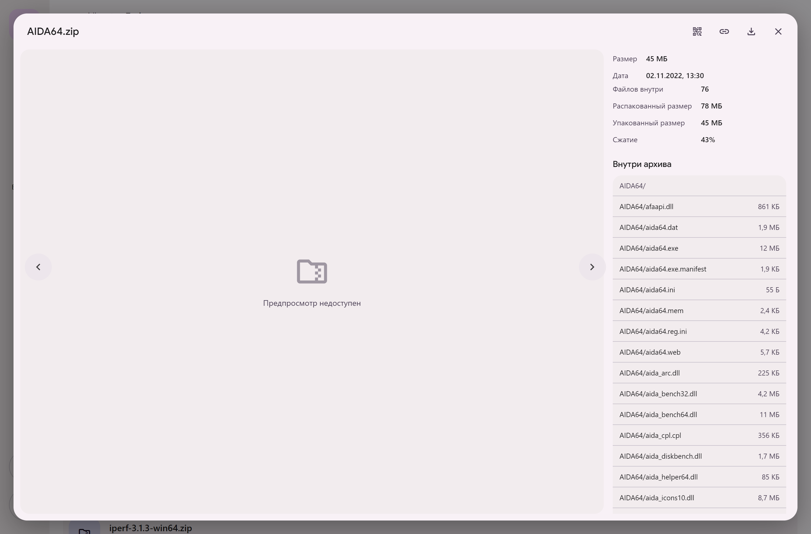
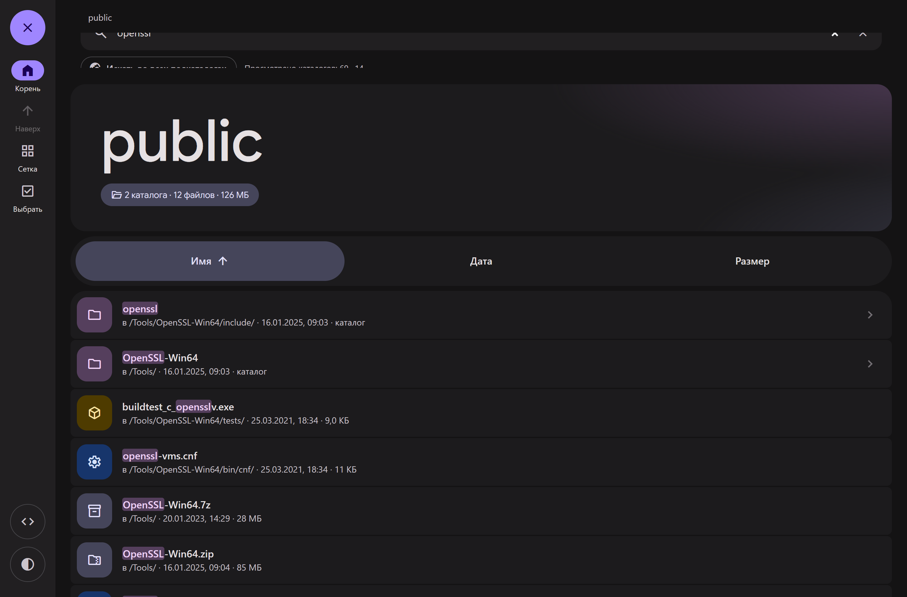
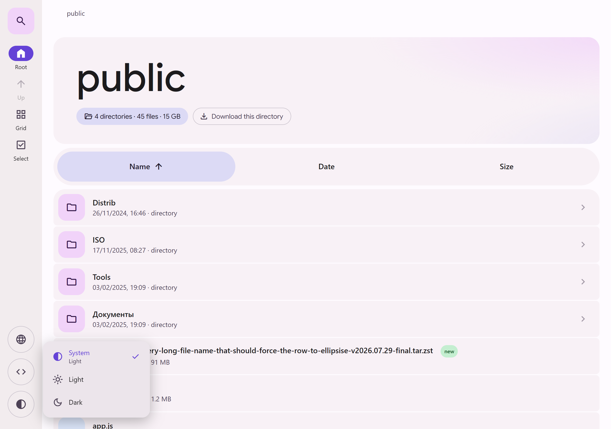
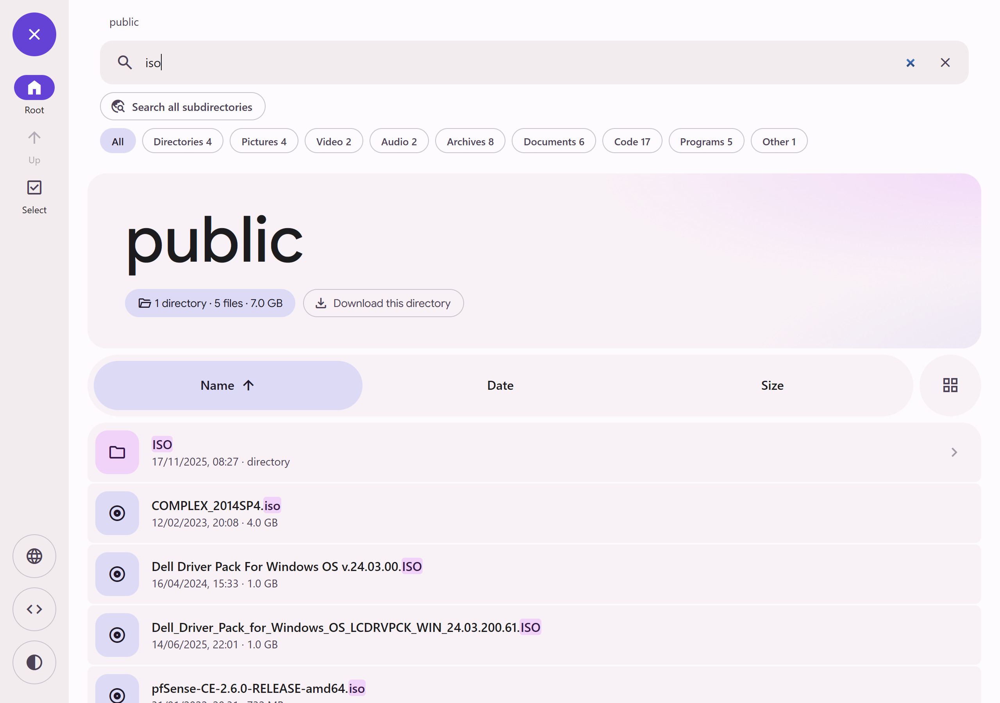

# m3listing

[🇬🇧 English](README.md) | 🇷🇺 **Русский**

Листинги каталогов nginx, выглядящие как **[m3.material.io](https://m3.material.io)** — та же
палитра, та же типографика, те же формы, та же анимация.

Ни бэкенда, ни сборки. nginx продолжает отдавать обычный вывод `autoindex`; браузер читает
этот блок `<pre>` и перерисовывает его в файловый браузер Material 3 с 88-пиксельной
навигационной рейкой сайта, hero-карточкой, полосой сортировки со вкладками и тональным
списком.

Три статических файла. Положить рядом с шарой и добавить две строки в nginx.

|                | было            | стало                                    |
| -------------- | --------------- | ---------------------------------------- |
| работа сервера | нет             | нет — по-прежнему один ответ `autoindex` |
| запросов       | 1               | 1 + css + js (оба кешируются) + шрифты   |
| JS выключен    | обычный листинг | обычный листинг (аккуратный откат)       |

<table>
  <tr>
    <td width="50%"></td>
    <td width="50%"></td>
  </tr>
  <tr>
    <td></td>
    <td></td>
  </tr>
  <tr>
    <td></td>
    <td></td>
  </tr>
  <tr>
    <td></td>
    <td></td>
  </tr>
  <tr>
    <td></td>
    <td></td>
  </tr>
</table>

## Как это работает

`ngx_http_addition_module` дописывает `top.html` перед ответом autoindex и `bot.html` после
него. `top.html` открывает документ, отдаёт обвязку и подключает скрипт; вывод nginx попадает
внутрь скрытого `<div class="rawwrap">`; `bot.html` закрывает документ.

По `DOMContentLoaded` скрипт обходит `pre a`, беря **href** как источник истины для имени
файла (nginx обрезает видимую подпись на 50 символах, но href — никогда) и текстовый узел
после каждой ссылки для времени и размера. Всё остальное — иконки, цвета, сортировка, поиск —
выводится на стороне клиента.

Если скрипт не нашёл блок autoindex или упал, он снимает класс `m3l-js`, который сам поставил
на `<html>`, и исходный листинг nginx снова становится видимым. То же самое происходит при
выключенном JavaScript: класс не ставится, поэтому ничего и не прячется.

## Установка

1. Скопировать `dist/` в каталог с точкой внутри отдаваемого корня, например
   `/var/www/html/.m3listing/`.

2. Направить туда addition-модуль:

   ```nginx
   location / {
       root /var/www/html/;
       autoindex on;
       autoindex_localtime on;
       autoindex_exact_size off;      # "on" тоже работает — см. ниже
       charset utf-8;

       add_before_body /.m3listing/top.html;
       add_after_body  /.m3listing/bot.html;

       # nginx отдаёт полный документ; вырезаем дублирующие теги
       sub_filter '<html>' '';
       sub_filter '<head><title>Index of $uri</title></head>' '';
       sub_filter '<body bgcolor="white">' '';
       sub_filter '</body>' '';
       sub_filter '</html>' '';
       sub_filter_once on;
   }
   ```

   Полный server-блок — в [`nginx/example.conf`](nginx/example.conf), вариант развёртывания в
   Docker с целиком инлайновым конфигом nginx в файле стека — в
   [`nginx/docker-compose.yml`](nginx/docker-compose.yml).

   > Если идёте путём Compose: **каждый `$` в конфиге надо писать как `$$`**. Compose
   > подставляет `$name` внутри `content:`, и обнулённые `$uri` и переменные лог-формата дают
   > листинг, который отдаёт 301 на `/` с пустыми access-логами.

3. Отредактировать блок `window.M3LISTING` в начале `top.html`:

   ```js
   window.M3LISTING = {
     title: "public", // имя, показываемое на странице
     lang: "auto", // 'auto' | 'ru' | 'en'
   };
   ```

   `title` — это бренд: он заполняет hero в корне, первую хлебную крошку и заголовок вкладки.
   По умолчанию берётся имя хоста, что редко читается хорошо, — поставьте что-нибудь короткое.
   В подвале указан этот репозиторий; если хотите ссылку на свой форк, поменяйте `repoUrl`.

`charset utf-8` важен: без него nginx отдаёт листинг без указания кодировки, и не-ASCII имена
приезжают кракозябрами.

Имя каталога с ассетами произвольное — оно должно лишь совпадать с двумя путями внутри
`top.html` и двумя директивами `add_*_body`.

**После правки `m3listing.css` или `m3listing.js` увеличьте `?v=` в обеих ссылках в
`top.html`.** Сам `top.html` не кешируется никогда (он подзапрос динамического листинга), а вот
css и js кешируются — и браузером, и любым прокси перед ним. Рассогласованная пара этих двух
файлов — единственный способ сломать страницу обновлением.

## Дизайн измерен, а не подобран на глаз

Каждое значение ниже снято с живого сайта пробами вычисленных стилей через Playwright
(рецепт пробы лежит в истории git каталога `tools/`), а не подобрано глазами:

|                           | светлая   | тёмная    |
| ------------------------- | --------- | --------- |
| оболочка                  | `#FEFBFF` | `#141314` |
| карточки и строки         | `#F8F1F6` | `#1C1B1D` |
| рейка                     | `#F2ECEE` | `#211F21` |
| поверхность при наведении | `#ECE5EB` | `#2A282B` |
| акцент                    | `#6442D6` | `#9F86FF` |
| активная пилюля           | `#DCDAF5` | `#45455A` |
| fab и чип каталога        | `#F1D3F9` | `#553F5D` |

**Типографика.** `Google Sans` начертанием **475** с `font-variation-settings: "GRAD" 0,
"opsz" 18` для крупного текста — именно этот странный вес использует сам сайт — и
`Google Sans Text` с `"opsz" 17` для всего остального. Иконки — `Google Symbols`, та же
гарнитура, что отдаёт сайт, поэтому **ось FILL умеет анимироваться** от контура к заливке при
наведении.

**Формы.** Карточки 24px, навигационные полосы 40px, элементы рейки и иконочные чипы 16px,
бейджи 32px, строки списка 8px внутри группы с 24px. Верхняя полоса несёт фирменный угол
сайта `0 0 40px 40px`.

**Анимация.** Сайт использует ровно одну кривую сглаживания, `cubic-bezier(.2, 0, 0, 1)`, в трёх
длительностях — здесь так же:

| длительность | что движется                                                                  |
| ------------ | ----------------------------------------------------------------------------- |
| `.2s`        | `font-variation-settings` иконок (морфинг FILL), оверлеи состояний            |
| `.3s`        | `border-radius` + `background-color` у реек, строк, вкладок, полей; появление |
| `.5s`        | перекрёстное затухание темы на всех поверхностях                              |

Свойства раскладки тоже анимируются — ширина рейки, отступ оболочки, поля hero, кегль
крупного шрифта, метрики строк и чипов, — поэтому **изменение размера окна проходит плавно**
через контрольную точку, а не рывком.

Плюс фирменная подача hero с самого сайта: тональная заливка, которая за 3 секунды при
загрузке разрешается из `blur(50px)` в `blur(8px)`, по её же keyframes с `blur`.

`tools/test-motion.mjs` проверяет это всё — что ни один переход не использует чужую кривую,
что наведение действительно морфит радиус угла, поверхность и заливку иконки, и что
`prefers-reduced-motion: reduce` обнуляет всё.

```
34/34 passed
```

**Акценты по типам файлов** — это собственные контейнерные цвета сайта (его бейджей, fab’ов и
пилюль), а не сгенерированная радуга: фиолетовые каталоги, розовая медиа, зелёные таблицы и
аудио, янтарные архивы и ключи, синие документы и код, красные PDF, нейтральный для остального.

## Шрифты и приватность

Две строки `@import` в начале `m3listing.css` — единственные внешние запросы. Google Sans,
Google Sans Text и Google Symbols отдаются с `fonts.googleapis.com` под
[ограниченной шрифтовой лицензией](https://fonts.google.com/license/googlerestricted) Google —
это фирменные гарнитуры Google, подключаемые так же, как их подключает сам сайт.

Удалите обе строки `@import`, и страница деградирует аккуратно: типографика откатится на
Roboto и системные шрифты, а каждая иконка заменится на встроенный SVG Material Symbols
(скрипт проверяет `document.fonts` и переписывает глифовые спаны, если гарнитура так и не
приехала). После этого с сервера не уходит ничего.

## Замечания

**`autoindex_exact_size`.** С `off` (по умолчанию) nginx округляет размеры до вида `732M`;
оболочка разворачивает их обратно в байты для сортировки и подсчёта итогов, наследуя
округление. С `on` nginx печатает точное число байт, итоги становятся точными, а наведение на
строку показывает точный размер. Поддерживаются оба варианта, настраивать ничего не нужно.

**`autoindex_format json`** _не_ используется. Его нельзя совместить с addition-модулем в одном
location, а href и так несёт необрезанное имя, так что единственное, что дал бы JSON, — точные
размеры, которые бесплатно даёт `autoindex_exact_size on`.

**`addition_types`** по умолчанию равен `text/html`, поэтому обвязка приклеивается к _каждому_
HTML-файлу, отдаваемому из этого location, а не только к листингам. Именно поэтому важен путь
отката: у настоящего HTML-файла нет `pre`, скрипт выходит, и файл отображается сам собой.

## Скачивание каталога целиком

Отсутствие бэкенда означает отсутствие серверного zip, поэтому диалог предлагает три способа,
которые действительно работают, и честно говорит, какой из них какой:

- **Сохранить на диск** — File System Access API. Браузер один раз спрашивает, куда положить,
  затем дерево воссоздаётся на диске, и каждый файл потоком идёт прямо в него через
  `response.body.pipeTo(writable)`, так что образ на 4 ГБ никогда не оседает в памяти. Файлы,
  уже имеющиеся с тем же размером, пропускаются, что делает прерванный прогон возобновляемым.
  Только Chromium; в остальных браузерах кнопка прячется сама.
- **Команда wget** — одна строка, копируется в буфер обмена, обход дерева вообще не нужен:
  wget сам ходит по страницам autoindex. `--cut-dirs` подставляется из глубины каталога.
- **Список для aria2c** — дерево обходится здесь и выписывается как входной файл aria2 с
  путями `out=`, поэтому структура сохраняется. Скормите его `aria2c -i list.txt -c -x4`.

Плоский подход «поставить каждый файл в очередь загрузок браузера» намеренно не предлагается:
атрибут `download` вырезает разделители пути, и дерево приезжает кучей.

## Чтение файлов без скачивания

nginx отдаёт статические файлы с `Accept-Ranges: bytes`, а нескольких килобайт с начала или с
конца файла хватает, чтобы ответить на большую часть вопросов о нём. Кнопка `info` на строке
открывает просмотрщик с панелью свойств, заполняемой из
[`dist/m3listing-probe.js`](dist/m3listing-probe.js):

| формат                          | читается                        | что возвращается                                             |
| ------------------------------- | ------------------------------- | ------------------------------------------------------------ |
| ZIP, APK, JAR, DOCX, EPUB       | хвост (~64 КБ)                  | полное оглавление, размеры, степень сжатия                   |
| ISO 9660                        | 2 КБ по смещению 32768          | метка тома, издатель, число блоков, дата создания            |
| JPEG, PNG, GIF, WebP, BMP, AVIF | начало                          | размеры, глубина цвета, а для JPEG — EXIF                    |
| MP4, MOV, M4A                   | начало, хвост если не faststart | длительность, разрешение, кодеки по дорожкам                 |
| Matroska, WebM                  | начало                          | длительность, название, дорожки с кодеком, языком и каналами |
| MP3                             | начало + хвост                  | теги ID3, битрейт, признак VBR, встроенная обложка           |
| FLAC                            | начало                          | точная длительность, частота дискретизации, теги, обложка    |

Запросы проб выстраиваются в очередь, потому что шара за nginx часто ограничивает число
одновременных соединений от клиента для крупных файлов, и пачка параллельных проб собрала бы
429-е вместо ответов.

## Возможности

- **Навигация без перезагрузки** — каталоги подгружаются и подменяются на месте, с History API
  и полосой загрузки, поэтому просмотр мгновенный
- **Рекурсивный поиск** по всему дереву, обходимому в фоне с ограниченной параллельностью;
  каждое найденное показывает каталог, откуда оно
- **Размеры каталогов по требованию** — кнопка с линейкой на строке каталога обходит его и в
  реальном времени сообщает настоящий итог
- **Оверлей-просмотрщик** для картинок, видео, аудио, PDF и текста, с `←`/`→` между файлами
  листинга и автопереходом для медиа
- **Миниатюры** для картинок, подгружаемые лениво по мере появления строк
- **QR-код** для ссылки на любой файл, генерируемый прямо на странице — из браузера ничего не уходит
- Чипы-фильтры по семействам файлов, построенные по тому, что реально есть в каталоге
- Панель поиска свёрнута по умолчанию; кнопка поиска в рейке, `/` или `Ctrl`/`⌘`+`K`
  раскрывают её (высота и прозрачность, фирменный контейнерный переход сайта), `Esc`
  закрывает и очищает
- Мгновенный поиск подстроки с подсветкой, а запрос дублируется в `?q=`, так что поиск —
  это ссылка, которой можно поделиться
- Набор с клавиатуры: буквы перепрыгивают к первому подходящему имени
- Бейдж «новое» на всём, что изменялось в последние несколько дней
- Сортировка по имени, дате или размеру вкладками; щелчок по активной вкладке меняет
  направление; каталоги первыми
- Виды списком и сеткой, запоминаемые в браузере; переключатель стоит справа от полосы
  сортировки, в начале того списка, который он переключает — как это делает файловый менеджер
- Светлая / тёмная / системная тема, запоминаемая в браузере, выбирается из меню, которое
  отмечает активный вариант и говорит, к чему сейчас склоняется система
- Навигационная рейка на десктопе, нижняя панель до 768px — фирменное адаптивное разделение сайта
- Кликабельные хлебные крошки, кнопка «вверх», `Backspace` и `Alt`+`←` для подъёма
- Стрелки двигают курсор по строкам, `Enter` открывает
- Кнопки копирования ссылки и скачивания на каждой строке
- **Множественный выбор и пакетное скачивание** — ведущий чип одновременно является флажком
  (при наведении превращается в галочку), `Ctrl`/`⌘`+клик и `Shift`+клик работают на строке,
  `Ctrl`/`⌘`+`A` берёт всё на экране, кнопка _Выбрать_ в рейке включает режим отбора для
  работы без указателя, а на телефоне — где в нижней панели для неё нет места — выбор
  начинается долгим нажатием на строку. Плавающая панель действий затем скачивает выбранные
  файлы или копирует все их ссылки.
  Загрузки запускаются по одной с интервалом ~350 мс, что сводит вопрос браузера «разрешить
  несколько загрузок?» к одному запросу. Бэкенда нет, поэтому нет и серверного zip — каталоги
  можно выбрать ради ссылок, но не скачать
- Итоги по каталогу: число элементов и суммарный размер того, что сейчас показано
- Русский и английский интерфейс: следует языку системы, а глобус в рейке открывает меню —
  Системный / Русский / English — переименовывающее всё на месте без перезагрузки. Оба меню
  управляются с клавиатуры и привязываются к рейке, где бы она ни была
- Отфильтрован мусор: `@eaDir`, `#recycle`, `Thumbs.db`, `.DS_Store`, сам каталог с ассетами
  (настраивается через `hide`)

## Разработка

```bash
pwsh tools/build-demo.ps1        # demo/index.html = top + мок autoindex + bot
py -m http.server 8777 --directory demo
node tools/shoot.mjs http://localhost:8777/ screenshots
node tools/test-motion.mjs http://localhost:8777/          # 44 проверки
node tools/test-probe.mjs http://your-share.example/       # нужны настоящие файлы
node tools/feature-shots.mjs http://your-share.example/ screenshots
node tools/qr-verify.mjs http://localhost:8777/ /tmp/qr    # затем zbarimg
```

Скрипты съёмки принудительно переключают интерфейс на английский, чтобы картинки в этом README
не зависели от машины, на которой их сняли.

Каждый скрипт управляет headless-Chrome по CDP и не тянет ни одной npm-зависимости.
`test-motion` покрывает формы, анимацию, покрытие глифами и пути взаимодействия;
`test-probe` требует развёртывания с реальными файлами за ним, потому что это единственное
место, где можно погонять парсеры Range.

## Лицензия

[MIT](LICENSE). Встроенные запасные пути иконок — [Material Symbols](https://github.com/google/material-design-icons),
Apache 2.0; веб-шрифты не распространяются, а только загружаются из Google Fonts под их
собственной лицензией. См. [NOTICE](NOTICE).

## Стандарт разработки

Репозиторий подключает общий стандарт версии 0.4.0. См. [русское руководство](docs/ru/development-standard.md) и [English guide](docs/en/development-standard.md). Локальный пакет проверяет секреты подготовленного коммита, форматирование изменённых файлов и двуязычную документацию до merge. Проверки продукта сохраняются. Подключение продолжается; приёмка продукта и перевод прежней документации учитываются отдельно в .repo-policy.json.
